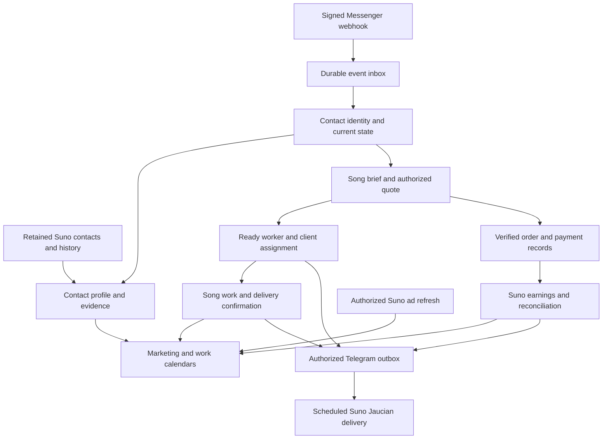

# Suno compatibility and complete feature plan

Implementation has begun under the owner's instruction to proceed. See [current implementation and open requirements](suno-implementation-status.md). Counts and findings below describe the original planning baseline; the current generated register includes sixteen declared app schedules, with legacy sync assigned a manual/recovery role.

Planning revision: November 14, 2026. This expands the earlier gap report into a feature, data and job plan. No application code, database schema/data, webhook, cron configuration or deployment was changed while preparing it.

## Required outcome

Deliver the Veo management feature set on Suno's existing business data and music workflows. Preserve Suno's current customer behavior and source records unless an explicitly reviewed replacement meets the same requirements. A feature is complete only when its interface, API, data, access rules, updates/background work and failure recovery all work together for Suno.

The default compatibility baseline is Suno: its seven-field song brief, customer-specific quotes, customer/staff handoffs, current Page settings, retained contacts/history, song delivery and confirmed earnings policy. Veo's screens, video fields, quotas, commission rates, URLs and source models are not automatically Suno business rules.

This is the planning stage requested by the owner. All implementation, migration and activation steps below remain pending.

## Coverage and evidence

| Inventory | Inspected coverage | Meaning |
| --- | ---: | --- |
| API route files | 125 | Every path assigned an explicit feature ID; methods/direct dependencies recorded |
| App page routes | 22 | Includes both calendar entrypoints, contact profile, workspace, legacy and diagnostic-adjacent surfaces |
| Non-test top-level UI components | 56 | Every component assigned an explicit primary feature ID |
| App cron endpoints | 17 | 12 declared Vercel schedules and five requiring external/delegated/manual-trigger disposition |
| Python bot route paths | 28 | Includes mode-specific reports, legacy Suno endpoints, archive/admin APIs, handoff, health and webhook |
| Existing Suno public tables | 30 | Read-only metadata inspection; no customer rows extracted |
| Existing information-schema column records | 411 | Baseline for field preservation/reconciliation, not a final target schema |
| Existing named database cron jobs | 1 active | `tokko-database-maintenance`, hourly at minute 17; do not disable it based on its inherited name |
| Source migration files | 172 | Full template inventory; not permission for a blind baseline replay |

The generated path register has zero unclassified API/page/top-level-component entries in these sets. This is source inventory coverage, not a claim that all behaviors or deployments have passed. Shared library internals, SQL functions/triggers, workspace subviews/action branches, Python bot flows and external provider settings require the additional checks below.

- [Every route, page and component](suno-route-register.md)
- [Machine-readable coverage, source fingerprints and direct dependencies](suno-feature-coverage.json)
- [Cron, nested worker and database scheduling register](suno-cron-register.md)
- [Data, contact profile and calendar contracts](suno-data-contracts.md)
- [Every existing Suno column, function name and trigger event](suno-current-data-field-register.md)
- [Earlier detailed gap evidence](suno-feature-gap-plan.md)
- [Previous build/test/HTTP evidence and limits](suno-verification.md)

The compared Veo source is the same as the copied source commits. Its feature paths are present in the new Suno copy. Veo production feature activation and external scheduler-provider configuration were not verified by this audit.

## Complete feature work register

All rows are planned requirements, not completed acceptance checks. The route register uses these IDs to connect implementation files with the required behavior.

| ID | Feature scope to preserve/provide | Suno compatibility and completion check |
| --- | --- | --- |
| F01 | Sign-in, personal account/profile, Telegram profile confirmation and session handling | Retain Suno identities; verify intended login transition and recovery; personal profile is separate from customer profile; test revoked/disabled access |
| F02 | Tenant isolation, Owner/team-leader/manager/member accounts, supervisor hierarchy, Page grants, team groups, offboarding | Tenant launch must retain other workspaces and existing jobs/grants; reject foreign Page ownership; map real Suno staff and branches; prevent role escalation; no accidental owner/staff lockout; access removal applies to cached reads and queued work |
| F03 | Pages, Facebook connection/OAuth, subscriptions, app ownership and token renewal | Preserve all 13 Suno Page identities/settings and the correct Meta app; reconnect only the intended Page; stale or wrong-app ownership cannot send |
| F04 | Team/worker dashboard, totals, context loading and available navigation | Every role sees appropriate Suno work and totals; no fabricated empty state during source failure; consistent Page/date/branch filters |
| F05 | Contacts, 7-day contacts, search, filtering, pagination and bulk operations | Retain historical contacts/IDs; read complete authorized results; old and new records remain usable; partial bulk failures are visible |
| F06 | Customer profile identity, editable details, auto-fill, custom fields and contact drawer | Preserve names/phone/email/business/context where available; manual corrections survive refresh; full page and drawer agree |
| F07 | Customer messages/timeline, grounded summaries, evidence, purposes, needs, problems and promises | Retained and new evidence is accessible with source dates/coverage; establish a full-profile update owner compatible with workspace mode |
| F08 | Customer orders, verified payments, refunds, balances, repeat-purchase/LTV/AOV and milestone durations | Keep monetary amounts/currencies, payment claims and verified records distinct; partial payments do not multiply orders; history remains labelled |
| F09 | Referral/ad attribution, source evidence and Facebook order/stage checks | Preserve source IDs and attribution provenance; unknown stays unknown; stale or failed source reads do not authorize a sale or send |
| F10 | Contact demographics, best supported insights, conversion projections and historical forecasts | Keep facts grounded and manual/saved priorities; retain model/version/cutoff; do not claim Veo-trained predictions are validated for Suno |
| F11 | Marketing calendar, monthly/day cohorts, Page/ad filters, contact drilldowns and conversion/spend views | Preserve inquiry versus order/payment dates and complete coverage; missing ad spend is unknown; reconciled per-Page/day totals |
| F12 | Work/earnings calendar, employee/day detail, planning, cash, orders, spend and adjustments | Philippine dates and confirmed Suno earnings/output units; safe current-scope caching; historical/new-period boundary; no incomplete financial total disguised as success |
| F13 | Ads connection, credentials/renewal, ad-account/Page mapping, spend, CPA/ROAS and scheduled refresh | Verify Suno access and source coverage; shared hourly claims across polling routes; no inheritance of Veo account/token bindings |
| F14 | Page ad budgets, Page/team plans and spend-supported allocation | Use Suno revenue/output definitions, scope and explicit unknowns; budgets do not silently alter earnings or assignments |
| F15 | Creative inventory/preview, ad creative performance and comparisons | Correct Suno ad/Page/creative association, permissions and time ranges; preserve links/samples; unsupported results stay unavailable |
| F16 | Seven-field song brief, optional customer form, partial answers, corrections and explicit resend | Merge existing Suno behavior; server validation uses the same song fields as UI; no cinematic/video-length defaults imposed on a song inquiry |
| F17 | Chatbot enable/model/voice/rules, trial flow, generation, fallback and analytics | Keep every Page's Suno settings; verify workspace chatbot opt-in and live inbound behavior; trial/reset cannot erase unrelated production state |
| F18 | RAG documents/chunks, uploads, image/video samples, Drive indexing, signed media and direct audio | Existing assets/embeddings remain compatible; no bucket/credential loss; distinguish already-supported manual audio from any newly scoped audio knowledge library |
| F19 | Pricing packages/promotions, free offers/freebies, customer offers and staff-approved conversation quotes | Retain exact customer quote/scope/conditions over older bot/RAG prices; song quantities/deposits/balances are supported; no cross-customer quote leakage; source freebie flows get an explicit disposition |
| F20 | Human takeover, bot permission, purchase intent, manual send/media and live stop checks | Preserve Suno handoff/review behavior while using newer guards; paid/proceeding/opted-out contacts stay protected; every send rechecks access/ownership |
| F21 | Workflow follow-ups, chatbot follow-ups, best contact time, pauses and continuation review | Preserve due jobs/instructions and timing evidence; one clear job owner; protect staff quotes and current stops; no automatic replay after partial delivery |
| F22 | Pipeline, tags/default/outcome tags, bulk tags and stage history | Retain IDs/manual decisions; reconcile current source and newer changes; automatic outcomes do not create a verified payment |
| F23 | Fresh inquiry pool, Ready/Busy, eligible worker rotation, offers, acceptance/expiry, reassignment and handover | Map Suno brief gate/timing and worker/Page/group access; one assignment owner; no historical backlog offered as new work |
| F24 | Work/production board, deadlines, song versions/revisions, `SONG SENT`/completion and handover history | Reconnect legacy song obligations to workspace assignments; distinguish assigned/paid/delivered; completion cannot duplicate a payment or change the seller silently |
| F25 | Receipt uploads/evidence slots, supervisor review/direct submission, order milestones, corrections/deletions | Define appropriate Suno evidence; enforce authorized review; keep audit/financial history distinct from removing a proof image; reconcile late changes |
| F26 | Earnings/statement periods, tips, refunds, daily finalization, adjustments, referrals/recruiter credit and incentives | Implement current/confirmed Suno policy; earnings and paid-out amounts remain separate; no implicit adoption of Veo 35%/40% rates; legacy recruiter/share tracking explicitly retained, superseded or reviewed |
| F27 | Today/tomorrow attendance, availability/Page-access surveys, capacity, quotas and workload | Validated humans and known declarations; attendance, Page permission and Ready are distinct; distinguish receipt count, paid orders and song deliveries; missing history is not zero capacity |
| F28 | Employee profiles, performance, rankings, concerns, alerts and warning evidence | Correct Suno branch/history/metrics and recipient privacy; approved alert rules and usable evidence; no video-production assumptions or automatic personnel penalties |
| F29 | Jaucian integration, account links, memberships, groups/topics, team/private reports and callbacks | Dedicated archive and one update-stream owner; configured Suno deep links and validators; verify all send/report/availability modes intentionally, including authorized Makata private-report behavior |
| F30 | Campaign create/edit/cancel, scheduled/instant/loop sends, recipients and tracked bulk messages | Preserve audience and pending/acknowledged state; authenticated worker triggers; current Page/access checks; duplicate protection and explicit failed recipients |
| F31 | Messenger templates, approval/status/submission, template sending and welcome messages | Correct Suno Page/app/template ownership, variables/media and channel validation; preserve current per-Page welcome behavior |
| F32 | Export queues, selected/all-contact exports, files/download/retry/expiry, Page history and archived records | Retained older history and launch-period event coverage are labelled; background processing continues after UI closes; scoped downloads and cleanup |
| F33 | Signed webhooks, partner routing, durable event inbox, collection health, identity sync and first-inquiry recovery | Persist before acknowledgment; ordered processing per conversation; dedupe across workers; no data gap or duplicate reply during event handover |
| F34 | Navigation, shared modal/toast/pagination, responsive layouts, loading/errors, caching and accessibility | Every supported feature remains reachable for the correct role; state/errors clear; no inaccessible controls or stale data after account/Page changes |
| F35 | Health, storage/resource monitoring, worker leases, diagnostics and retry/reconciliation screens | Per-worker success/failure/backlog, bounded load and recovery; diagnostic/vintage surfaces explicitly restricted or retired with no loss of business capability |
| F36 | Schema/RPC/trigger/index compatibility, backup, retention, private files and deployment recovery | Reconcile both branches, retain Suno-only delivery records, preserve stable IDs/settings; rehearse incremental upgrade and failure/restart scenarios |

Every row must retain its existing Suno capability or have a tested compatible replacement. Any proposed removal, changed coverage or postponed source feature must be explicit in the plan/review; it must not disappear as an implementation side effect.

## Contact profile and calendar completion requirements

The profile is not complete after displaying a name and a summary. Its required sections include identity/controls, song brief, custom quote, messages/timeline, grounded facts, corrections, source/ad evidence, orders/payments/balances/LTV, follow-up attribution, best contact time, supported demographics/projections, song-work status and refresh/coverage indicators. See the 14-section checklist in the data contracts.

Both calendars remain in scope:

- **Marketing/inquiry calendar:** customer cohorts, monthly/day views, Page/ad filters, drilldowns, outcome coverage, spend and conversion measures.
- **Work/earnings calendar:** authorized worker/team/Page views, orders, cash, work/output, planning, earnings and adjustments by Philippine business date.

They must use the same underlying authorized contact/order/payment data without equating their different date/metric definitions. Reconcile displayed totals to detailed rows and source records; retain older history and source coverage; never replace a failed read with zero or a misleading successful partial total.

## Confirmed compatibility hotspots to resolve

| ID | Finding | Required resolution |
| --- | --- | --- |
| C01 | Song-form and staff-quote helper integrations from existing Suno are absent from the first copy | Port behavior and preserve existing Suno tests/records |
| C02 | SQL assignment eligibility recognizes video fields | One shared Suno field definition for UI, extraction, validation and assignment |
| C03 | Telegram URL generation and allowlists contain the Veo hostname | Configure both sides with Suno origin and test foreign-origin rejection |
| C04 | Five cron routes lack copied Vercel schedules | Inspect actual external/delegated triggers and give every feature a documented owner |
| C05 | Workspace mode skips `/cron/chatbot` without the separate chatbot opt-in | Explicit feature-switch matrix and live inbound/follow-up checks |
| C06 | Workspace mode substitutes demographics enrichment for the legacy full-profile worker; the latter returns a skip in that mode | A compatible owner for full profile facts/summaries/retained evidence, not just a renamed cron |
| C07 | Workspace exports switch to launch-period inbox records; several historical sync/finance paths are blocked by middleware | Label actual export/history coverage and preserve required retained-history functions through scoped replacements |
| C08 | The follow-up cron's nested campaign request has no bearer header, while workspace middleware requires one | Shared internal function or authenticated service call; end-to-end continuation test |
| C09 | Multiple routes reach events, chatbot jobs and ads; source retention jobs can overlap | Durable item claims, named primary owners, checkpoints, bounded batches and reconciled cleanup responsibility |
| C10 | Veo financial/capacity rules and output terminology are copied unchanged | Confirm Suno policy and keep money, receipts, orders and songs as separate measures |
| C11 | Bot workspace dispatch bypasses legacy song dispatch; new-client-only mode limits reports/availability and old queued actions | Explicit supported action/mode contract; integrate song jobs and report schedules without reviving duplicate legacy senders |
| C12 | New workspace middleware changes login/access and rejects Facebook-token sessions for app use | Retain Suno identity/Page OAuth ownership and verify the intended account-login transition before cutover |
| C13 | Existing Suno app deployment runs tests then build; copied Veo configuration only builds | Restore a meaningful deployment test gate and resolve inherited critical-path failures |
| C14 | Video/business-specific prompts, aliases and predictive artifacts remain in the copy | Replace song workflow assumptions; label or disable unvalidated Suno predictions until their evidence is established |
| C15 | Three Suno/Veo migration versions collide; Veo has two duplicate-version groups; a Suno delivery table is absent from Veo declarations | File/hash/object-aware incremental migration and preservation plan |
| C16 | Source route presence does not cover diagnostics/vintage/auth exposure in every feature-flag state | Explicit public/signed/session/service-only boundary matrix for preparation, workspace and recovery modes |
| C17 | Pre-workspace Facebook webhook processing already calls the journal when the handoff secret is configured; missing journal RPCs can return 503 before legacy processing | Rehearse additive schema and compatible-webhook deployment order; verify signed ingestion before and after the launch watermark without silently losing or repeating an event |
| C18 | Six explicit bot paths are blocked with 410 in workspace mode, including Suno Makata, capacity, planning and report replacement/member paths | Preserve required Suno capability with an authorized replacement; catalogue legacy freebie/referral/survey/report flows instead of silently treating them as working or removing them |

These are source/metadata findings, not proof that Veo production is broken in all those configurations. They are reasons not to assume the copied configuration is immediately Suno-compatible.

## Data and background-work dependencies

Historical evidence may inform a profile/calendar without becoming a fresh assignment, a new payment or a new commission. Profile/calendar reads do not own Telegram sending. Every arrow needs a defined source, stable key, access scope, stale/failure state and duplicate/retry behavior.

## Feature-switch and scheduling design

| Switch/setting family | Planned check |
| --- | --- |
| Workspace enablement | Schema, owner/teams, login, contact/history access, jobs and webhook handover must all be ready; no isolated global flip |
| Workspace chatbot opt-in plus Page/contact controls | Explicitly retain intended Suno automation and respect all current Page/contact holds |
| Bot new-client-only/reviewed-deal/availability/report modes | State exactly which feature actions may be queued/delivered; full requirements must not be suppressed accidentally |
| Page allowlist/runtime ownership | Suno's project, 13 approved Page identities and Meta app ownership checked on reads, sends and jobs |
| Financial confirmation, receipt review and auto-approval | Current/confirmed Suno policy only; review settings must not bypass evidence/access |
| Source/enrichment/ads/model choices | Correct providers and saved credentials, model/index compatibility, bounded work and honest missing/unknown states |
| Recovery and operational pauses | Defined behavior for incoming events, due jobs, cached reads and restart; no silent event loss or unapproved replay |
| Cron/service authentication | Valid in every deployed mode, including nested requests, fallback dispatch and private maintenance |

Use the cron register for all 17 routes, nested workspace tasks, the existing database maintenance job, source storage protection and the dedicated bot minute dispatcher/watchdog/fallback. Verify external providers before deciding a route is unused. Do not install duplicate schedulers just to give every endpoint a timer.

## Implementation sequence and deliverables

### Phase 1 — Baseline and requirements

Freeze the feature/data/job registers as the review baseline. Confirm the intended Suno earnings, brief/assignment threshold, readiness/acceptance timing, song completion/revision rules and pilot destinations. Preserve current behavior where already established. Record authentication/role/Page access and all existing external triggers without printing secrets.

Deliverables: feature acceptance matrix; baseline metadata/settings/domain reconciliations; per-worker trigger/owner map; explicit unresolved decisions.

### Phase 2 — Suno domain merge

Merge song intake, quote handling and existing handoff/delivery guarantees into the copied architecture. Define consistent song fields and units across profile, pricing, assignment, work, reports and server validation. Adapt URLs/prompts/defaults and model disclosures. Specify song assignment/completion events supported by the new dispatcher.

Deliverables: tested behavior contracts, Suno business adapter/configuration design, field/ID mappings, allowed-action/feature-switch design. A newer helper may replace an old one only after the relevant behavior is proven.

### Phase 3 — Incremental schema and retained-data rehearsal

Reconcile migration branches and actual database definitions. Prepare an incremental plan, backup procedure, scoped restoration rehearsal, transformation/reconciliation reports and reversal limitations. Preserve existing Page configurations, user/contact IDs, Suno-specific delivery state, assets and evidence.

Deliverables: reviewed per-object migrations and mappings, before/after comparison results, permissions/index checks and repeat-run/resume evidence. No full baseline replay against the running CRM.

### Phase 4 — Complete the app's data-backed features

Wire accounts/teams, contacts and full profiles, both calendars, source evidence, pricing, financial views, campaign/follow-up tools, media/knowledge, templates/welcome, exports/history, work/production and staff/planning views to their correct Suno contracts. Verify every page/subview/action and its authorized role. Keep unsupported inference/data explicit rather than filling it with Veo defaults.

Deliverables: F01–F36 implementation status and evidence, role/Page compatibility matrix, profile/calendar drilldown reconciliation, saved-setting/data regression checks. The calendars and contact profiles are required features, not implied future follow-up work.

### Phase 5 — Background work and Jaucian integration

Set up the dedicated bot archive/service, verified identity/group/topic/Page mappings and compatible deep links. Assign and secure every app worker, nested task, database job, webhook and bot dispatcher/failover. Reconcile old/new worker ownership and paused pending jobs. Add metrics and controlled retry/reconciliation behavior.

Deliverables: 17/17 cron-route dispositions, all nested/SQL/bot jobs accounted for, auth and overlap tests, current-state health and scheduler recovery evidence. Actual dispatch verification uses approved normal scheduling, not manual test posts.

### Phase 6 — Full verification

Restore a deployment test gate; triage the 18 reproduced upstream failures and complete a sequential resource-aware regression run. Verify representative retained/new Suno data through every feature ID, all 22 page routes and underlying actions. Test both calendars, all required contact-profile sections, all worker modes, auth boundaries and failure cases. Perform interactive sign-in/visual/mobile/accessibility checks that were unavailable during initial preparation.

Deliverables: feature/data/job acceptance evidence, full failure inventory with ownership and no undisclosed skips, measured worker/backlog behavior and operator runbook.

### Phase 7 — Scoped pilot and rollout

Use one explicitly approved Suno Page/group scope with the intended feature set. Check the complete inquiry → song brief/quote → assignment → human work → verified payment → song delivery → earnings/report/calendar/profile flow. Observe normal scheduled recovery, pending-job handover and historical access. Expand to all 13 Pages only after the scoped checks pass and the owner accepts the cutover plan.

Deliverables: pilot reconciliation, final trigger/settings inventory, handover/rollback instructions and a feature coverage record. No feature is silently removed or declared complete from its file count.

## Release acceptance and evidence rules

- Every F01–F36 row has its UI/API/data/access/worker/failure checks recorded, or an explicitly reviewed disposition that preserves required Suno functionality.
- Every route/page/component remains classified after changes; new upstream paths fail the inventory review rather than disappear into a catch-all.
- All 28 explicit Python bot paths and their delegated resource/action branches have a tested mode/access/disposition record; the six workspace-mode 410 paths have compatible replacements wherever required by Suno.
- All 13 Suno Pages and intended staff roles are checked individually for configuration and scope.
- The contact profile passes its section checklist, and both calendars reconcile to correctly dated/currency-separated source data and drilldowns.
- All 17 app cron routes, nested tasks, database jobs, external triggers and bot jobs have a primary owner and visible recovery/health behavior.
- Preserved contacts/history/quotes/settings/assets and acknowledged message/payment state survive migration and restart.
- A duplicate webhook, concurrent tick, old worker overlap, partial send, source outage, expired token, Page-access revocation and manual bot-off are tested.
- No Veo database, group, staff identity, deep link or financial assumption leaks into the Suno instance.
- Live activation is distinct from source/build/test preparation. External deployment/scheduler state remains unverified until inspected in that stage.

The next work is to review this plan and resolve its business decisions. Implementation has not started under this planning request.
